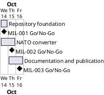

# Project Plan

## Metadata
| Key | Value |
| --- | --- |
| ID | PP-001 |
| CrossReference | [BC-001], [SA-001], [MIL-001], [MIL-002], [MIL-003] |
| Language | en |
| Domain | it |

## Version History
| Date | Status | Author | Reviewer | Change | Commit |
| --- | --- | --- | --- | --- | --- |
| 2026-10-14 | Accepted | Jens Tirsvad Nielsen | AI as stand-in for S01 | Initial version, accepted as Product Owner stand-in (no QC checklist for PP yet); plan accepted by S01 in chat | [f42e610] |

---

## Purpose

Schedule the three phases that deliver the Day 30 NATO alphabet assignment as a tested and documented repository: foundation, converter, documentation and publication. The plan runs against the Business Case's constraint of a small personal project with one pull request per milestone.

## Planning Assumptions

- The plan starts 2026-10-14 and ends by 2026-10-16.
- Each phase is one day of work and one pull request that closes its issues.
- S01 is owner and reviewer of every gateway; in autonomous mode the AI acts as S01's stand-in and every review record says so.
- The language of the planning documents is English (registry `Languages`); the wiki is written in English, Danish and Bahasa Malaysia.
- The git host is the Gitea instance at `git.tirsystem.com`; its token comes from the git-ignored `.env`.

## Gateway Schedule

| Gateway | Document | Window | Decision date | Owner | Stories | Main deliverable | Milestone |
| --- | --- | --- | --- | --- | --- | --- | --- |
| Repository foundation | [MIL-001] | 2026-10-14 to 2026-10-14 | 2026-10-14 | S01 | none | Project configuration, package skeleton, Doxyfile, CI workflow, ADRs, repository description and topics | |
| NATO converter | [MIL-002] | 2026-10-14 to 2026-10-15 | 2026-10-15 | S01 | US-001 | Working console program with pytest tests and Doxygen comments | |
| Documentation and publication | [MIL-003] | 2026-10-15 to 2026-10-16 | 2026-10-16 | S01 | none | README, screenshots, wiki in en, da and ms | |



## Scope Coverage

| Business Case scope item | Gateway |
| --- | --- |
| Console program and NATO data loader | [MIL-002] |
| Project structure, `pyproject.toml`, `constants.py`, `.gitignore`, `Doxyfile` | [MIL-001] |
| pytest test suite | [MIL-002] |
| CI workflow that runs the tests | [MIL-001] |
| README, wiki (en, da, ms) and screenshots | [MIL-003] |
| Repository description and topics | [MIL-001] |

## Dependencies

```
MIL-001 → MIL-002 → MIL-003
```

A No-Go on a gateway holds the later ones until the cause is fixed and the gateway is reviewed again; later windows shift by the same days.

## Plan Risks

| Risk | Impact | Mitigation |
| --- | --- | --- |
| The host token lacks scope for repository settings or wiki | MIL-001 or MIL-003 cannot finish | Stop and report (autonomous-mode stop rule); S01 supplies a token with the scope |
| The CI runner on the host is not available | CI workflow cannot be proven green | The workflow is verified by running the same commands locally; the gap is recorded in the review |
| Wiki translation takes longer than planned | MIL-003 slips | Wiki pages are short and share one structure |

## Open Issues

- "Python greater than 3.13" is read as 3.13 or newer (`requires-python = ">=3.13"`); S01 can tighten it.
- `.env` also holds a GitHub token and user; no GitHub mirror was requested, so they are not used.
- Screenshots are rendered from the real program output (a terminal-style image), because a desktop screenshot cannot be taken from an unattended run; S01 may replace them with native captures.

---

[BC-001]: ./business-case.md
[SA-001]: ./stakeholder-analysis.md
[MIL-001]: ./milestones/mil-001-repository-foundation.md
[MIL-002]: ./milestones/mil-002-nato-converter.md
[MIL-003]: ./milestones/mil-003-documentation-and-publication.md
[f42e610]: https://git.tirsystem.com/Tirsvad-Udemy-100-days-of-code/030-nato-phonetic-alphabet/commit/f42e6109ac82937291e5c8207c0631f710b9da85
