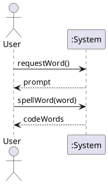
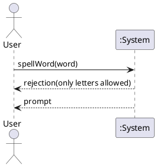

# SSD-001 Spell a Word

## Metadata
| Key | Value |
| --- | --- |
| ID | SSD-001 |
| CrossReference | [UC-001] |
| Language | en |
| Domain | it |

## Version History
| Date | Status | Author | Reviewer | Change | Commit |
| --- | --- | --- | --- | --- | --- |
| 2026-10-14 | Accepted | Jens Tirsvad Nielsen | AI as stand-in for S01 | Initial version, reviewed in RC-013 | [80ec1bc] |

---

## Source Use Case

Spell a Word ([UC-001]) — scenario: main success scenario. The alternate flow 3a (invalid character) is drawn separately below.

## Diagram

Alternate flow 3a, a word with a character that is not a letter:

## System Operations

| Step | Message | Parameters | Return | Use case step |
| --- | --- | --- | --- | --- |
| 1 | requestWord | none | prompt asking for a word | 1, 2 |
| 2 | spellWord | word | the list of code words, or a rejection for a non-letter | 3, 4 and 3a |

## Lifecycle Notes

The tool runs one session per start; it keeps no state between words. The data is loaded once when the session starts.

---

[UC-001]: ./uc.md
[80ec1bc]: https://git.tirsystem.com/Tirsvad-Udemy-100-days-of-code/030-nato-phonetic-alphabet/commit/80ec1bc3640e1aa2ad1f152b9f71df39fa71c2d1
