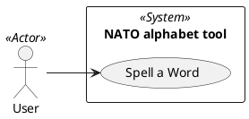

# Use Case Diagram

## Metadata
| Key | Value |
| --- | --- |
| ID | UCD-001 |
| CrossReference | [SA-001], [BC-001], [US-001], [UC-001] |
| Language | en |
| Domain | it |

## Version History
| Date | Status | Author | Reviewer | Change | Commit |
| --- | --- | --- | --- | --- | --- |
| 2026-10-14 | Proposed | Jens Tirsvad Nielsen | AI as stand-in for S01 | Initial version, adapted from the 026 NATO alphabet project | pending |

---

## Purpose and Scope

The boundary is the NATO alphabet console tool. One actor, the User, asks the tool to spell a word. Everything outside the console program (the course platform, the git host, the wiki) is outside the boundary.

## Diagram

## Actor Table

| Actor | Stereotype | Stakeholder ID (SA) | Goals (use cases) |
| --- | --- | --- | --- |
| User | `<<Actor>>` | S01, S02 | Spell a Word |

## Use Case Table

| Use Case | Actor(s) | Goal |
| --- | --- | --- |
| Spell a Word | User | Get the NATO code word of each letter of a word, so the word can be spelled out over the phone |

## Relationships

| From | Relationship (`<<include>>` / `<<extend>>`) | To | Justification |
| --- | --- | --- | --- |
| None | - | None | A single use case has no include or extend relationship |

---

[SA-001]: ./stakeholder-analysis.md
[BC-001]: ./business-case.md
[US-001]: ./user-stories.md
[UC-001]: ./uc-001/uc.md
