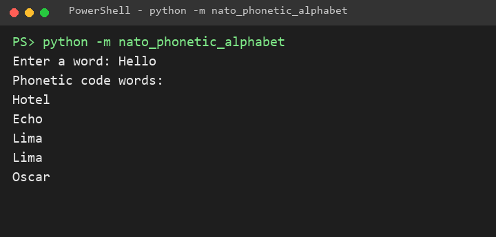
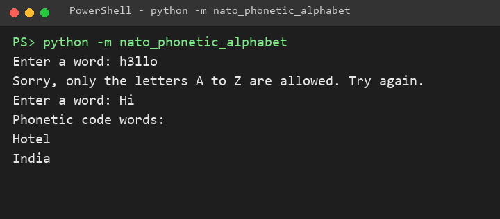

# Brug

🌐 [English](Usage) · **Dansk** · [Bahasa Melayu](Usage-ms)

Aktivér det virtuelle miljø (se [Installation](Install-da)), og start programmet:

```bash
python -m nato_phonetic_alphabet
```

Den installerede kommando gør det samme:

```bash
nato-phonetic-alphabet
```

## Stav et ord

Programmet spørger efter et ord og skriver NATO-kodeordet for hvert bogstav i rækkefølge. Store og små bogstaver giver samme resultat.



## Ugyldigt input

Et ciffer, et mellemrum eller et tegn er ikke et bogstav. Programmet siger det og spørger igen.



## Tryk Ctrl+C eller Ctrl+D

Afslutter du inputtet (Ctrl+D på Linux og macOS, Ctrl+Z og Enter på Windows) eller trykker Ctrl+C, lukker programmet stille.
